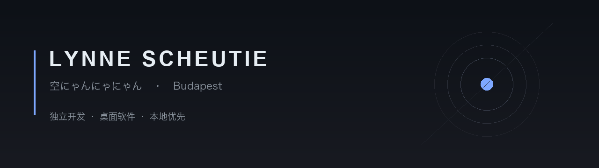

  

  
  
  
  

---

## 在做

<table>
<tr>
<td width="33%" valign="top">

### ScheutieOS

把 `chat.deepseek.com` 装进一个独立窗口，顺手补上网页端最缺的东西：把长对话结构化导出成 PDF 或 Markdown，还带字数统计。

macOS 用 Swift + WKWebView，Windows 用 C# WinForms + WebView2，两边统一 8.4.2。

[下载](https://github.com/LynneScheutie/ScheutieOS_Download) · [源码](https://github.com/LynneScheutie/ScheutieOS)

</td>
<td width="33%" valign="top">

### Cadence

4K 目押音游的桌面版。S / D / J / K 四键，五档难度，带演示模式、暂停与计分。

macOS 与 Windows 都能直接跑，不用开浏览器。

[下载](https://github.com/LynneScheutie/Cadence_Download)

</td>
<td width="33%" valign="top">

### Zen Deck

优绩主义防内耗机器。把日常该做的事做成卡池，抽一张就去做一张。

[下载](https://github.com/LynneScheutie/Zen_Deck_Download)

</td>
</tr>
</table>

---

## QuotOS Aurora Lab

另外在做一个独立软件小组，做法律工具与桌面端小应用。

**法法典 Lawlearn** — 离线法条库配 AI 解释，62 份司法解释 2835 条，四卷结构
**Sermo** — QuotOS Aether 的独立 macOS 客户端，七家服务商
**Speculum** — 视频下载，自带 yt-dlp 与 ffmpeg

[去看看](https://github.com/QuotOS-Aurora-Lab)

---

## 一点偏好

做出来的东西有几个共同点：**本地优先**、**独立窗口**、**不依赖浏览器标签**。

数据能留在这台机器上，就不往上送。

---

<blockquote>

柏浪涛：「この荒唐無稽な世界、人は虚無を求めても、無所求ではいられない。」

</blockquote>
